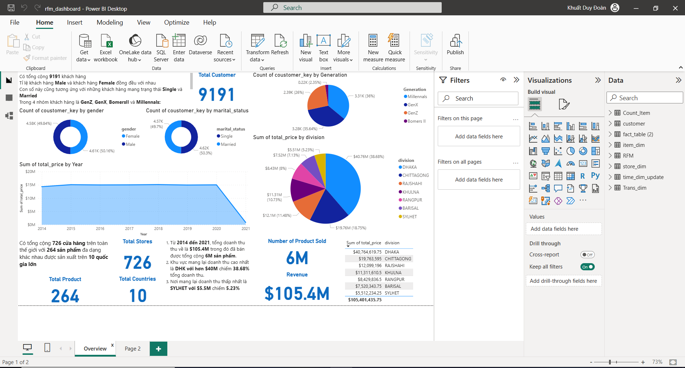
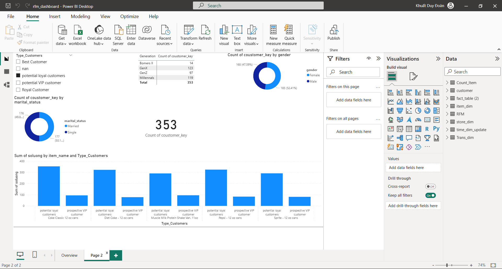

# Customer Segmentation & RFM Analysis

## Overview
This project analyzes customer purchasing behavior using RFM analysis to identify high-value customer segments and support business decision-making.

## Tools Used
- SQL
- Python
- Power BI

## Business Question
Which customer groups bring the most value to the business, and how can marketing campaingns be tailored to each group to increase purchase frequency and retention?

##  Data
- **Source:** https://www.kaggle.com/datasets/mmohaiminulislam/ecommerce-data-analysis
- **Size**: 6 tables, 9191 customers, ~ 1 million transactions
- **Period:** 2018-2021

## Dashboard Preview

### Overview Dashboard

### Customer Dashboard

